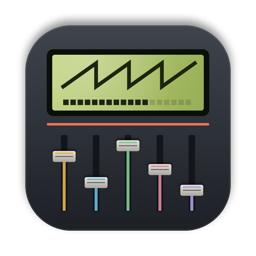
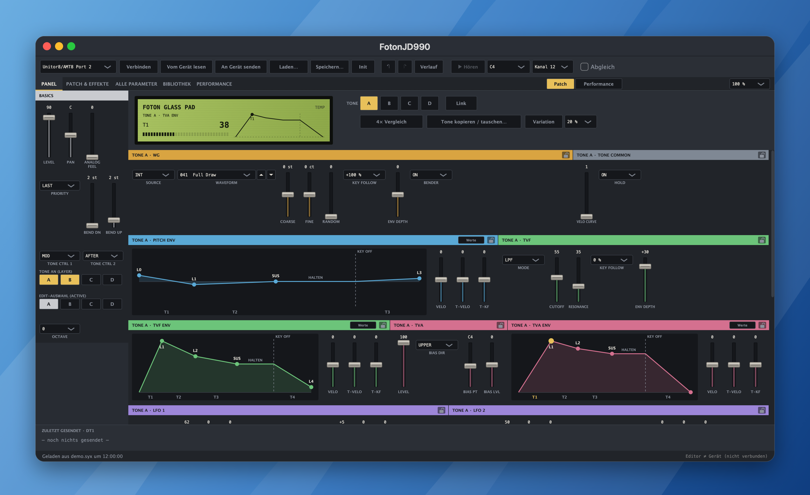
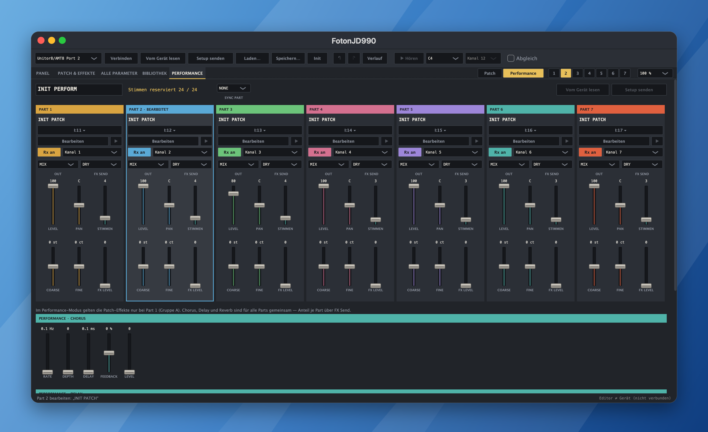

<p align="center">
  
</p>

<h1 align="center">FotonJD990</h1>

An open-source editor and librarian for the **Roland JD-990** synthesizer module
(1993). It talks to the device purely via MIDI System Exclusive and borrows its
look from the iconic front panel of the JD-800.

> **Status: work in progress.** Developed and tested on macOS with a real JD-990.
> Patch editing, librarian and Performance mode work against the hardware; a
> Linux build is untested, Windows has not been tried. Expect rough edges.



## Features

- **Every patch parameter** (190 of them) editable live: the device follows every
  fader move immediately.
- **JD-800-inspired panel** with section colours, a green LCD that sketches what
  you are touching (envelopes, LFO, filter, effects), and an "all parameters"
  expert view.
- **Draggable envelopes** for pitch, filter and amplifier: drag points for time
  and level, ⇧ for fine steps, ⌥ to lock one axis, double-click to reset.
- **Effects as a signal chain:** reorder group A/B effects by drag & drop, with a
  small sketch display per effect.
- **Performance mode:** seven parts with their own patch and MIDI channel, mixer
  strips, voice reservation (x/24), shared chorus/delay/reverb. Every part's patch
  can be edited with the full patch editor.
- **Librarian:** SQLite library with tags, favourites, search, "find similar
  patches", A/B compare, morph, weighted random variation, diff between patches,
  import/export of `.syx` and `.mid`, bulk read of all internal patches.
- **JD-800 patch import** with conversion to JD-990.
- **Undo history** with jump-to-step, group locks for variation/morph, tone
  copy/swap, 4-tone compare view, link mode, UI zoom (80–200 %).



> **Note on language:** the user interface is in German, and so are the design
> documents in [`docs/`](docs/). This README is the English entry point.

## Safety first

The JD-990's patch memory is battery-backed RAM from 1993. The editor therefore
**never writes to internal memory.** It only writes to the device's temporary
edit buffers (temp patch, temp performance and the seven part patches) plus the
patch/performance mode switch. This is enforced by an address whitelist in both
the Rust MIDI layer and the app. Back up your device first anyway:

```bash
cargo run -q --release -p jd990-cli -- backup my-jd990-backup   # read-only
```

## Building (macOS)

Requirements: Xcode Command Line Tools, CMake ≥ 3.22, Rust (via
[rustup](https://rustup.rs)), and [JUCE](https://juce.com) 9.0.2.

```bash
git clone https://github.com/andremotz/foton-jd990.git && cd foton-jd990
git clone --depth 1 --branch 9.0.2 https://github.com/juce-framework/JUCE.git host/JUCE

cargo test                                                 # core, codec, round-trip tests
cmake -S host -B host/build -DCMAKE_BUILD_TYPE=Release
cmake --build host/build -j
open host/build/FotonJD990_artefacts/Release/FotonJD990.app
```

The CMake build compiles the Rust core as a static library automatically.

## Connecting the JD-990

- Connect MIDI in **and** out; enable *Rx Exclusive* on the JD-990.
- Pick your MIDI port in the drop-down at the top left. The app reconnects on its
  own when the interface appears.
- The SysEx device ID is currently fixed to **17** (the JD-990's default *Unit #*).
  A setting for other IDs is on the to-do list.
- The audition button plays on a selectable channel (patch mode) or on the
  selected part's channel (performance mode).

## Command line tool

`jd990` covers backups, file conversion and hardware checks:

```bash
cargo run -q --release -p jd990-cli -- show patch.syx          # all parameters
cargo run -q --release -p jd990-cli -- convert jd800.syx out.syx
cargo run -q --release -p jd990-cli -- probe                   # does the device answer?
cargo run -q --release -p jd990-cli -- hil-sweep tvf            # set/read back/verify parameters
```

Run it without arguments for the full list.

## How it is built

| Path | Contents |
|---|---|
| `spec/` | **Single source of truth:** every parameter, address and value table as TOML. Codec, validation, UI metadata and tests are generated from it. |
| `crates/` | Rust: spec parser and codegen, core (patch/performance model, SysEx, device rules, morph, JD-800 conversion), MIDI transport, SQLite library, CLI, C ABI |
| `host/` | JUCE 9 desktop app (C++), UI reference-image tests in `host/tests` |
| `design/` | HTML layout prototype, icon, and the script that renders the README screenshots |
| `docs/` | Design documents and 22 architecture decision records (in German) |

The parameter map was cross-checked three ways: the official MIDI implementation
in the owner's manual, [JDTools](https://github.com/sagamusix/JDTools), and
hardware-in-the-loop sweeps that set every parameter on a real JD-990, read the
whole patch back and check that nothing else changed.

## Tests

```bash
cargo test                                        # Rust (no hardware needed)
cargo clippy --all-targets -- -D warnings
sh crates/jd990-ffi/tests/c_smoke.sh              # C ABI
host/tests/ui_snapshots.sh                        # pixel-exact UI reference images (macOS)
```

## License

Copyright © 2026 André Motz.

This project is licensed under the **GNU Affero General Public License v3.0 or
later** (see [LICENSE](LICENSE)). It uses [JUCE](https://juce.com) under the
AGPLv3, and data structures and the JD-800 → JD-990 conversion from
[JDTools](https://github.com/sagamusix/JDTools) by Johannes Schultz (BSD 3-Clause).
See [THIRD-PARTY-NOTICES.md](THIRD-PARTY-NOTICES.md).

Roland, JD-990 and JD-800 are trademarks of Roland Corporation. This project is
not affiliated with or endorsed by Roland. No Roland factory patches, manuals or
panel artwork are included.
